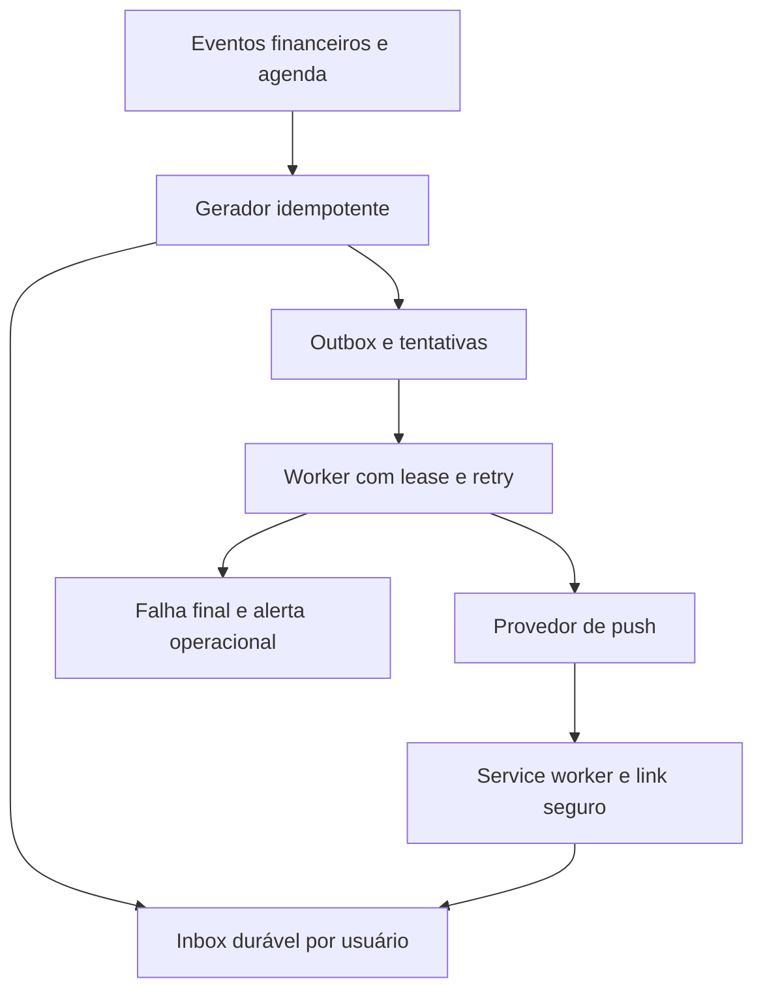

# ZXP Finance — auditoria para SaaS, experiência de uso e notificações

**Data:** 30/09/2026 (UTC). **Código auditado:** `3b81f0e91d9a7cd8e91276d87bac824ead18db0a`.

**Repositório:** https://github.com/caua-lima/zxp-finance  
**Aplicação:** https://financeiro-eight-beige.vercel.app/  
**Entrega:** diagnóstico técnico, correções priorizadas, especificação de UX, arquitetura de notificações, critérios de lançamento e prompt completo para Claude Code na seção 10.

## 1. Parecer e limites

**Eu não lançaria esta versão como SaaS aberto.** Há uma base aproveitável — funções financeiras separadas, testes, componentes compartilhados e uma interface com identidade — mas persistem falhas de autorização, inconsistências financeiras e um envio de notificações sem recuperação confiável. O maior risco não é visual: é outro cliente conseguir administrar usuários, ou a aplicação apresentar dinheiro estimado como disponível.

Esta é uma auditoria aprofundada do código acessível e da superfície pública, não uma certificação de ausência de bugs. Fiz revisão dos caminhos de autenticação, administração, persistência, cálculos, páginas, notificações e configuração; executei a suíte, lint, build, auditoria de dependências e reproduções locais. Nenhum dado financeiro real foi alterado; não fiz push, deploy, exploração destrutiva ou envio de notificações em produção.

A interface pública redirecionou para `/login`. Inspecionei o login visualmente e pela árvore de acessibilidade. Não recebi sessão de teste: as conclusões sobre telas autenticadas são de código, não de navegação completa em dispositivos reais. Não tive acesso ao console Firebase/Vercel, regras efetivamente publicadas, variáveis secretas, plano contratado, logs do cron, backup ou observabilidade. Não foi demonstrado que o deploy contém exatamente o SHA auditado. Esses pontos são gates pendentes, explicitados abaixo.

**Classificação:** P0 bloqueia abertura do SaaS; P1 deve ser corrigido antes de piloto com clientes; P2 precisa ser tratado para uma experiência sustentável. “Confirmado no código” não significa explorado em produção. “Lacuna” identifica capacidade não encontrada na base, sem afirmar que inexiste em serviços externos.

## 2. Evidências executadas

| Verificação | Resultado desta auditoria | Limite da conclusão |
|---|---|---|
| Clone e identificação | HEAD `3b81f0e…`, working tree sem alterações ao terminar a inspeção | Snapshot do repositório |
| Instalação | `npm ci --ignore-scripts` concluído | Scripts de instalação não executados |
| Testes | **158 testes, 32 suítes, 158 aprovados** | Principalmente funções puras; não cobrem autorização, Firestore Rules, navegador ou entrega push |
| Lint | `npm run lint` sem erros reportados | Não prova correção funcional |
| Build sem env | Compilou e depois falhou em prerender com `auth/invalid-api-key` | Configuração ausente localmente, não prova falha do deploy |
| Build com placeholders do CI | **Build concluída**, incluindo TypeScript e 23 páginas estáticas | Sem conexão com Firebase real |
| Dependências | `npm audit --json`: **4 pacotes sinalizados: 1 crítico, 3 altos** | Severidade do scanner; explorar depende do caminho e ambiente |
| Login público | HTTP 200; redirecionamento da raiz para login no navegador | Sem login autenticado |
| APIs sem credencial | `/api/usuarios`, `/api/desejos-em-aberto`, `/api/cron/notificacao-diaria`: **401** | Proteção contra anônimos; não comprova autorização entre usuários |
| Service worker | `/sw.js`: HTTP 200 | Não comprova registro, inscrição ou recebimento |
| Cabeçalhos | HSTS presente; CSP, X-Frame-Options e X-Content-Type-Options ausentes nas respostas amostradas | Fortalecimento necessário; não implica XSS demonstrado |

Reproduções locais com funções atuais:

| Entrada / cenário | Resultado observado | Problema |
|---|---|---|
| `café 15.50` | valor **50**, descrição `café 15` | Número decimal fragmentado |
| `R$ 15.50 café` | valor **15**, descrição `.50 café` | Centavos perdidos |
| `15.50 reais café` | valor **15,50** | Interpretação inconsistente conforme o marcador |
| `ontem gastei 20 reais café` | valor 20, sem data no resultado | O hook grava no dia atual |
| Último dia: saldo inicial 100, gasto hoje 30 | saldo atual 70; UI calcula restante **40** | Gasto já descontado do saldo é subtraído novamente |
| Original +30 antes da referência; estorno −30 depois; referência 70 | saldo **100** antes de apagar o par, **70** depois | Apagar par de soma zero não é neutro nesse modelo |
| Simulação com `meses=0` e parcela 1.000 | `viavel:true`, lista de meses vazia | Falta validar domínio |
| Rendimento com saldo final 100, 2 dias a 0,05% | 0,10 | Se primeiro dia tinha 1.000, só aquele dia já renderia 0,50; usar saldo final retroativamente está errado |

### Evoluções que devem ser preservadas

A versão atual já usa `calcularSaldoAtual` tanto no Resumo quanto na tela Saldo. Também adicionou faturas previstas, comissão projetada no mês seguinte, melhor resumo de parcelas, vencimento efetivo e navegação mobile com quatro destinos mais “Mais”. Há `sucessoSe` que espera o resultado da operação antes de anunciar sucesso. Não recomendo desfazer esses avanços.

A antiga Agenda foi removida. Portanto, problemas específicos daquela página não são classificados como bugs atuais. A simplificação do saldo agora registra diferença no histórico sem criar um gasto de ajuste; é melhor para evitar confusão, mas ainda exige uma definição financeira consistente.

## 3. Segurança, isolamento e operação SaaS

### S01 — P0 — qualquer usuário autenticado alcança administração global

**Evidência:** `src/app/api/usuarios/route.ts` GET/POST e `src/app/api/usuarios/[uid]/route.ts` PATCH/DELETE chamam apenas `verificarChamador`. Depois usam service account para listar, criar, editar ou excluir usuários. PATCH aceita email, senha e `disabled` para o UID recebido na rota. DELETE só impede excluir a própria conta.

**Impacto:** um cliente comum pode, pelo caminho de código, administrar outro cliente e potencialmente assumir sua conta trocando credenciais. Ocultar `/acesso` não resolve.

**Correção:** autorização server-side de administrador global, separada de proprietário de workspace. Bloquear por padrão; bootstrap do primeiro administrador por operação confiável; nunca ler papel de um campo editável pelo próprio cliente. Preferir convite/reset seguro a administrador conhecer senhas. Auditar operações privilegiadas no servidor.

**Aceite:** anônimo 401; cliente comum 403 em todos os verbos; administrador permitido; usuário A não lista nem altera B. Testar rotas e regras, não só menu.

### S02 — P1 — dependências com alertas de segurança

**Evidência:** Next `16.2.12`; scanner sinalizou `next` crítico, `sharp`, `postcss` e `js-yaml` altos. O advisory oficial GHSA-2xp9-vwfh-vxw4 descreve risco na otimização de AVIF e lista correção em 16.3.3. O scanner sugeriu Next 16.3.7 no dia da auditoria. Outro alerta do Next é específico de servidores Windows; não se deve atribuí-lo automaticamente ao ambiente Vercel.

**Correção:** validar releases atuais e atualizar lockfile, Next/eslint-config-next e transitivas coerentemente, com testes e build. Não executar `npm audit fix --force` às cegas. Avaliar se os caminhos vulneráveis são acessíveis; não afirmar exploração por existir advisory. Abrir SaaS com alerta crítico sem triagem é inaceitável.

**Aceite:** scanner atualizado sem alertas aplicáveis não tratados; exceções documentadas por pacote, condição e prazo. Fonte oficial: https://github.com/vercel/next.js/security/advisories/GHSA-2xp9-vwfh-vxw4

### S03 — P1 — isolamento por UID existe, mas regras não protegem invariantes

**Evidência:** `firestore.rules` permite leitura e escrita recursivas sob o próprio UID. Não há validação de campos, tipos, limites, propriedade de dados derivados ou transições de estado.

**Impacto:** o banco não está simplesmente aberto ao público, mas um cliente autenticado pode adulterar saldos, fechamento, auditoria, inscrições push e campos que o servidor posteriormente consome. Tipos TypeScript não validam documentos remotos.

**Correção:** regras por coleção, campos permitidos e imutáveis; escrita de auditoria, papéis, totais críticos e entregas exclusivamente por serviços confiáveis. Mutações financeiras validadas e atômicas. Testes no emulador devem tentar valores negativos indevidos, NaN, campos extras, owner falso e acesso cruzado.

### S04 — P1 — trilha de auditoria alterável pelo auditado

**Evidência:** `src/lib/auditoria.ts` anexa logs no batch do navegador; S03 permite alterar/excluir os mesmos documentos.

**Correção:** eventos de auditoria append-only gerados por serviço confiável, com ator, operação, IDs relacionados, timestamp do servidor e identificador de requisição. Não registrar senha, tokens ou payload financeiro completo sem necessidade. Um log no mesmo batch é útil para atomicidade, mas não é prova confiável se o cliente pode reescrevê-lo.

### S05 — P1 — verificação manual de token incompleta para administração

**Evidência:** `src/lib/googleAuth.ts:verificarIdToken` verifica assinatura, algoritmo, emissor, audience, subject e expiração. Não consulta revogação nem estado atual `disabled`; não valida `iat`/`auth_time`.

**Correção:** adotar verificador suportado compatível com a build ou completar a implementação com testes contra contrato oficial. Rotas privilegiadas precisam de autorização atual, revogação e política de reautenticação. Evitar mudar biblioteca sem investigar a incompatibilidade histórica documentada no projeto.

### S06 — P1 — integração Tasks não possui identidade por cliente

**Evidência:** `/api/desejos-em-aberto` autentica chamador, mas chama `listarDesejosEmAberto()` sem UID. `tasksBridge.ts` usa um único `TASKS_API_URL` e segredo global.

**Impacto:** todos os usuários percorrem a mesma integração; não há segregação demonstrada. A configuração e o comportamento do serviço remoto não foram acessados.

**Correção:** antes do SaaS, desativar por padrão ou criar vínculo individual autenticado, escopos mínimos e verificação de ownership. Não repassar apenas um UID arbitrário e tratá-lo como autorização.

### S07 — P1 — fronteiras de entrada e de custo insuficientes

**Evidência:** rotas recebem JSON e usam checagens superficiais; Consultor não limita comprimento da pergunta nem orçamento por cliente; ferramenta do modelo é aceita como `EntradaFerramenta` sem validação em runtime. `anthropicClient.ts` e ponte não oferecem uma política operacional completa de timeout/cota por tenant.

**Correção:** schemas de entrada, limites de corpo e valores, resposta 400/422 para domínio inválido, 429 para cota, timeout, custo máximo por requisição e orçamento diário. Validar saída da IA como entrada não confiável. Não confiar em prompt para aplicar regras de negócio.

### S08 — P1 — endpoint push controlado pelo cliente é usado pelo servidor

**Evidência:** `usePushNotifications.ts` grava endpoint e chaves diretamente; regras aceitam qualquer formato; cron passa os valores a `webpush.sendNotification`.

**Impacto:** existe uma superfície de requisição server-side a destino escolhido pelo cliente; risco de SSRF/abuso precisa de teste isolado. Não foi explorado em produção.

**Correção:** cadastro por API autenticada, HTTPS e provedores suportados validados, rejeição de endereços locais/privados e destinos inesperados, proteção contra redirecionamentos/DNS indevido conforme transporte, limites por usuário e chaves bem formadas. Proteger também a alteração posterior do documento.

### S09 — P2 — endurecimento HTTP ausente na amostra

**Evidência:** `next.config.ts` vazio; cabeçalhos de defesa ausentes em `/login` e rotas amostradas, além de HSTS já presente.

**Correção:** CSP inicialmente em Report-Only, depois enforce, compatível com Next/Firebase; `frame-ancestors`, `nosniff`, Referrer-Policy e Permissions-Policy deliberadas. Não bloquear microfone se voz é uma funcionalidade. Não classificar ausência de CSP como XSS já existente.

### S10 — P1 — exclusão de login não é exclusão do cliente

**Evidência:** `usuariosFirebase.ts:excluirUsuario` apaga Auth, sem workflow de dados Firestore, inscrições, conexões, histórico ou exportação.

**Correção:** suspensão imediata e cancelamento de jobs; exportação e exclusão por workflow idempotente com retenção definida; remoção de tokens; tratamento de backups e estado parcialmente concluído. Separar exclusão da conta de simples bloqueio de acesso. Não apagar clientes existentes numa migração automática.

### S11 — P2 — lifecycle comercial e recuperação não demonstrados

**Evidência:** inventário de rotas não contém onboarding completo, recuperação de senha, plano/assinatura, checkout do SaaS, portal do cliente, exportação ou política de uso. O login público oferece somente entrada.

**Correção:** definir MVP comercial: cadastro/convite, email verificado conforme política, reset seguro, workspace pessoal, onboarding, limites e suporte. Se houver cobrança, implementar entitlement server-side, webhooks idempotentes e transições de pagamento. Backup/restauração e documentos de privacidade precisam de comprovação operacional e revisão responsável; a inspeção do repositório não confirma sua existência externa.

## 4. Integridade financeira

### F01 — P1 — gasto diário descontado duas vezes

**Evidência:** `src/app/(app)/saldo/page.tsx:98–104`: saldo já líquido de gastos alimenta `calculateGastavelPorDia`; o resultado ainda subtrai `totalGastoHoje`.

**Correção:** escolher um único contrato. Sugestão: “Disponível por dia daqui em diante” = saldo livre atual / dias restantes, sem nova subtração. Se quiser “orçamento de hoje” fixo, persistir base do início do dia e subtrair apenas gastos posteriores a ela. Não remendar com `Math.max(0)` sem corrigir a semântica. Alinhar push e tela à mesma função.

### F02 — P1 — curva de caixa usa saldo atual como saldo inicial do mês

**Evidência:** `useFinanceDashboard.ts` passa `saldoReal` para `calculateDailyCashFlow(entries, mes-01, ultimoDiaMes, saldoReal)`. A função reaplica entradas e saídas do mês inteiro.

**Impacto:** movimentos já contidos no saldo podem reaparecer na curva. **Correção:** histórico parte de saldo de abertura conhecido; projeção parte de uma referência atual e só considera eventos posteriores ainda não refletidos. Separar realizado e previsto e explicar quando não há saldo de abertura confiável.

### F03 — P1 — marcar pago/recebido não registra movimento de caixa

**Evidência:** `usePagamentos.ts:marcar` escreve só o checklist; `calcularSaldoAtual` depende de referência e gastos. Um pagamento feito depois da referência não reduz caixa automaticamente.

**Correção:** definir um ledger de movimentos efetivos e vínculo com obrigação. Pagamento gera movimento uma única vez ou vincula transação importada já existente. Antes da migração, UI deve explicar o modelo manual. Nunca simultaneamente debitar fatura e cada compra do cartão no mesmo caixa.

### F04 — P1 — estorno não é protegido contra concorrência

**Evidência:** `useGastos.ts:estornar` testa `original.estornado` em estado React, cria ID aleatório e usa batch. Duas abas podem aprovar a mesma pré-condição e creditar duas vezes.

**Correção:** transação com leitura atual e ID determinístico ou idempotency key. Estorno deve referenciar original e não poder ser estornado novamente por caminho inadequado. Testar duas solicitações simultâneas, não apenas cliques sequenciais.

### F05 — P1 — exclusão do par estorno/original muda saldo

**Evidência:** `useGastos.ts:remover` presume que soma zero torna seguro apagar ambos. `calcularSaldoAtual` só soma registros posteriores à referência. Com original antes e estorno depois, essa premissa é falsa; reprodução na seção 2.

**Correção:** preservar fatos financeiros com arquivamento/contrapartida ou recalcular explicitamente o efeito relativo à referência numa operação consistente. Não manter exclusão definitiva como se fosse sempre neutra. Mesmo apagar um gasto normal posterior à referência altera caixa: a interface precisa deixar claro o efeito e garantir consistência do histórico.

### F06 — P1 — parser interpreta valores errados e perde data

**Evidência:** `parseGastoTexto.ts:NUMERO` privilegia alternativa que captura inteiros antes do decimal com ponto. “Ontem” é ruído; `useGastos.adicionar` usa `Date.now()` e mês atual. Na página Saldo, `registrar` salva automaticamente o valor interpretado, tornando o erro mais sério do que numa prévia.

**Correção:** gramática monetária pt-BR com tratamento explícito de ponto decimal e separador de milhar, rejeitar ambiguidade e mostrar prévia editável com data/conta/categoria. Reconhecimento de voz não deve lançar silenciosamente dado ambíguo. Repetição de confirmação usa chave idempotente.

### F07 — P1 — rendimento estimado modifica saldo confirmado

**Evidência:** `useRendimentoAutomatico.ts` soma resultado de CDI a `saldo.valor` e `caixinha.saldo`; ausência de configuração significa 100% CDI. O texto da UI diz que o rendimento entra sozinho. Não existe consulta de crédito real do banco nesse caminho.

**Impacto:** estimativa bruta de benchmark vira dinheiro disponível; pode haver dupla contagem entre saldo e caixinhas virtuais ou entre projeção e futuro extrato importado.

**Correção:** separar `rendimentoEstimado` de `rendimentoCreditado`; estimativa nunca altera caixa confirmado. Default de conta sem produto identificado não deve presumir rendimento. Exibir fonte, taxa, período e atualização. Só lançamento confirmado/conciliado muda saldo. Não prometer reproduzir Mercado Pago apenas multiplicando CDI.

### F08 — P1 — rendimento retroativo usa principal final

**Evidência:** `aplicarRendimentos` pega saldo de agora e aplica todas as taxas pendentes; caixinhas também usam saldo atual. Não há série diária dos aportes/retiradas nem vigência histórica do percentual de CDI.

**Correção:** se estimativa for mantida, calcular por intervalos de principal e taxa, com política de arredondamento e datas efetivas. Aportes atuais não rendem em dias anteriores. Alteração de taxa não deve reescrever todo período pendente. Crédito importado prevalece sobre estimativa.

### F09 — P1 — transação de rendimento não inclui todas as leituras relevantes

**Evidência:** `useRendimentoAutomatico.ts:84–103` lê gastos fora da transação usando `atualizadoEm` do snapshot anterior. Na transação, relê saldo, mas reutiliza `gastoDepois` antigo. Inicialização de `rendimentoAte` também usa `updateDoc` fora da transação.

**Impacto:** atualização simultânea da referência ou novo gasto pode tornar o principal inconsistente. A transação protege repetição de dias, não toda a base de cálculo.

**Correção:** remover escrita especulativa no saldo real; para materializações, usar ledger/versionamento e watermark consistente. Testar corrida com atualização de saldo e gasto concorrente.

### F10 — P2 — rendimento só tenta uma vez por sessão JavaScript

**Evidência:** `execucoes`, Map global, guarda Promise por UID; falha vira `null` e permanece em cache. Não há invalidação por dia ou reconexão.

**Impacto:** app aberto de um dia para outro não atualiza; uma falha transitória persiste até recarga. **Correção:** refresh por data, visibilidade e reconexão com backoff; status e “Tentar novamente”. Cálculos confirmados devem vir de job ou evento confiável, não depender de abrir uma tela.

### F11 — P1 — recorrências atuais reescrevem histórico

**Evidência:** adapters filtram contas/assinaturas pelo estado atual `ativa` e montam meses a partir dos valores atuais; `useMonthClose` salva snapshot, mas as leituras do DRE continuam derivadas dos cadastros. Fechamento é travado em partes da UI, não nas regras.

**Correção:** instâncias mensais ou versões com vigência; fechamento imutável server-side, reabertura auditada e relatórios lendo o snapshot/materialização correta. Mudar assinatura de R$50 para R$60 em outubro não deve alterar setembro fechado.

### F12 — P1 — data real de pagamento é descartada

**Evidência:** `usePagamentos` transforma documentos em `Set` de IDs e perde `pagoEm`; adapters recebem apenas booleano. `calculateDailyCashFlow` cai em `dueDate` quando falta `paidAt`.

**Correção:** preservar valor liquidado, data efetiva, conta, status e referência da transação. Competência, vencimento e liquidação são datas distintas. Não apresentar fluxo histórico de caixa usando vencimento como se fosse pagamento conhecido.

### F13 — P1 — projeção de comissão é substituída por correspondência frouxa

**Evidência:** `comissaoPrevista.ts` considera qualquer ganho pontual do mês com categoria Comissão ou descrição iniciando “comissão”; não exige `recebido`, vínculo com origem ou valor equivalente. Prevê recebimento no dia 1 e imposto fixo.

**Impacto:** comissão pequena de outra origem pode suprimir projeção maior; categoria/texto não são chaves de conciliação. **Correção:** vínculo explícito por competência/origem, liquidação parcial e residual. A simples substituição por ganho planejado pode ser válida, mas precisa estar vinculada e preservar diferenças.

### F14 — P1 — faturas previstas podem desaparecer sem resolução

**Evidência:** `devePreverFatura` deixa de prever após o vencimento; `faturasPrevistasParaEntries` elimina “Cartão não informado” quando qualquer fatura real existe. Não há confirmação de que a obrigação desconhecida foi coberta.

**Correção:** manter estado “valor a confirmar” com origem e motivo; não rotular estimativa como dívida vencida certa, mas também não fazê-la sumir. Exigir mapeamento do cartão e permitir reconciliação. Pagamento de previsão deve se vincular à fatura real por ID estável, não apenas nome editável.

### F15 — P1 — Consultor opera com orçamento incompleto

**Evidência:** `contextoFinanceiro.ts` usa saldo bruto de referência, não subtrai gastos posteriores, exclui parcelas/assinaturas `naFatura`, porém não carrega faturas. Usa parcelasRestantes estáticas. Simulador aceita zero/negativo/NaN sem guardas; resposta do modelo pode vir sem ferramenta.

**Correção:** reutilizar o mesmo snapshot financeiro validado do painel, incluindo faturas e obrigações futuras sem duplicação. Sem dados suficientes, responder “não consigo avaliar”. Validar horizonte inteiro limitado e valores finitos positivos. Resposta de viabilidade deve depender de resultado estruturado, não apenas instrução de prompt. Não usar “pode comprar” como garantia.

### F16 — P1 — caixinhas virtuais não têm cobertura financeira garantida

**Evidência:** `useGastos` acrescenta `porGasto` a caixinhas sem debitar reserva do saldo disponível; não espera `useCaixinhas.loading`. Ajustes absolutos podem sobrescrever incrementos concorrentes. Editar gasto não recalcula necessariamente seus efeitos vinculados.

**Correção:** escolher reserva virtual ou conta bancária real. Reserva virtual é alocação de dinheiro existente, não criação de ativo extra. Registrar transferência/alocação atômica, impedir cobertura impossível ou indicar explicitamente déficit. Não perder alocação por hook ainda carregando. Caixinha com rendimento estimado continua sendo estimativa.

### F17 — P1 — timestamps do cliente definem o que entra no saldo

**Evidência:** gastos e referência usam `Date.now()`; cálculo usa `criadoEm > atualizadoEm`.

**Impacto:** relógios diferentes, gravação offline, mesma resolução temporal e importações retroativas afetam inclusão. **Correção:** separar data efetiva, momento de registro do servidor e watermark/versionamento de conciliação. IDs/timestamps não substituem vínculo explícito do movimento à referência. Dinheiro deve usar centavos inteiros ou decimal com política única, incluindo divisões.

## 5. Notificações: diagnóstico e arquitetura necessária

“Funcionar 100%” deve significar que o sistema registra cada evento elegível, tenta enviá-lo conforme política, recupera falhas e informa o estado correto. Não é possível garantir que todo push aparecerá ou será lido: permissão, conectividade, sistema operacional e provedor estão fora do controle exclusivo do app. **A central interna deve ser durável; push é um canal adicional.**

O código já possui alguns cuidados corretos: segredo no cron, VAPID fora do cliente quanto à chave privada, permissão solicitada por ação, `serviceWorker.ready` na ativação, instrução específica para iOS, `event.waitUntil` no push e remoção de inscrições 404/410. Preservá-los.

### N01 — P1 — inscrição não acompanha corretamente a identidade

**Evidência:** `AuthContext.logout` só executa `signOut`. `usePushNotifications` verifica inscrição do navegador, mas não confirma o vínculo com o UID atual. A mesma inscrição pode continuar registrada no usuário anterior, ou ficar registrada para mais de um usuário.

**Impacto:** vazamento de notificações financeiras em dispositivo compartilhado; conta B pode ver “ativo” embora apenas A esteja cadastrado no servidor.

**Correção:** inscrição tem proprietário autenticado e geração de vínculo. Login/troca de conta faz reconciliação; logout revoga associação server-side antes de perder credencial e limpa vínculo local, com recuperação se offline. Não reutilizar silenciosamente endpoint para nova identidade. Por padrão, payload deve ser genérico: revogar associação não recolhe pushes já aceitos pelo provedor.

### N02 — P1 — indicador “ativo” não significa que o envio funciona

**Evidência:** efeito de inicialização define `ativo=!!sub`, sem consulta ao cadastro remoto; erro de registro é engolido. Desativar faz unsubscribe antes de apagar documento; se a segunda operação falhar, próxima tentativa pode não encontrar a inscrição local para remover o registro antigo. Não há renovação completa nem caminho de diagnóstico/teste.

**Correção:** estados explícitos: sem suporte, precisa instalar, permissão pendente/negada, registrando, vinculado, teste pendente, degradado e expirado. Endpoint de status por dispositivo; reparo idempotente no login/reconexão, sem solicitar permissão automaticamente. Tratar mudança de inscrição e rotação VAPID.

### N03 — P1 — falhas temporárias somem e reexecução duplica mensagens

**Evidência:** cron captura erros de `sendNotification`; só trata 404/410. Não registra tentativa, 429/5xx, próximo retry ou evento único. Reexecutar o cron reenvia tudo. Service worker não usa `tag` por evento.

**Correção:** inbox persistente + outbox com ID determinístico; retries com backoff/jitter e `Retry-After`; prazo de validade do conteúdo; dead-letter após limite. TTL de resumo diário não pode permitir mensagem “hoje” dias depois. `tag` ajuda a apresentação, mas não substitui idempotência do backend.

### N04 — P1 — processamento serial e sem checkpoint não escala

**Evidência:** `maxDuration=60`; loop de usuários, várias coleções históricas e loop de aparelhos serializados. `listarUsuarios` consulta Auth uma vez, sem paginação explícita; diferentemente, `listarDocumentos` já pagina Firestore. Usuários desabilitados não são excluídos do fluxo por uma condição visível.

**Correção:** fila persistente de jobs por usuário/evento, concorrência limitada, cursor/checkpoint, lease e recuperação. Enumerar corretamente toda a população ou manter índice de assinantes elegíveis. Isolar falha de um cliente para não interromper o restante. Não assumir que “aumentar maxDuration” resolve a arquitetura.

### N05 — P1 — janela de vencimentos perde fronteiras de mês

**Evidência:** cron procura fatura apenas com `f.dados.mes === mesPadrao()`, depois verifica marcos 5/1/0. No final de setembro, a fatura de início de outubro não é buscada; uma fatura de setembro prorrogada para outubro também pode desaparecer da consulta em outubro. Uma execução perdida no marco exato não é recuperada.

**Correção:** consultar por intervalo de vencimento efetivo, incluindo obrigações de competências adjacentes. Materializar evento com `dueAt`, `validUntil` e data local; catch-up deve enviar somente conteúdo ainda útil. Testar virada de ano, fevereiro e feriados. Calendário bancário é fallback: data confirmada da instituição deve prevalecer quando disponível.

### N06 — P2 — conteúdo e frequência foram feitos para um único perfil

**Evidência:** cron sempre avalia comissão esquecida em dias de trabalho e checklist no dia 8; há uma agenda global `0 11 * * *` (11h UTC, 8h em São Paulo), sem preferências por categoria/usuário. Avisos de fatura só cobrem valores reais lançados; contas fixas e assinaturas não possuem a mesma cobertura de lembrete individual.

**Correção:** preferências por assunto, canal, horário local, dias silenciosos e detalhes visíveis. Comissões opt-in para quem usa módulo. Diferenciar aviso confirmado de previsão. Evitar múltiplas interrupções redundantes no mesmo dia; permitir resumo agrupado.

### N07 — P1 — conteúdo financeiro exposto e destino sem validação explícita

**Evidência:** textos do cron incluem saldo/valores; `sw.js` usa `dados.url` diretamente e testa origem com `includes` para escolher janela.

**Correção:** conteúdo discreto por padrão e opt-in para valores; validar destino com URL e igualdade de origem, permitir somente rotas do app; preferir `notificationId` com rota segura. Após login, verificar proprietário antes de abrir o detalhe. Esperar navegação/foco corretamente. Não usar URL do payload como autorização.

### N08 — P1 — métricas de sucesso não demonstram entrega

**Evidência:** `notificouAlgo=true` depois de chamar `enviar` mesmo se todos os envios falharem; contador `usuariosNotificados` pode crescer sem envio aceito. Não há inbox, comprovante por tentativa ou alerta operacional visível na base.

**Correção:** distinguir evento criado, tentativa, aceito pelo provedor, exibido quando houver confirmação instrumentada e lido/clique. Ausência de confirmação não prova falha nem sucesso. Logs estruturados sem endpoint/token, correlação por job e health check do cron. Falha total não pode terminar com aparência de sucesso operacional.

### Arquitetura proposta



Modelo mínimo, adaptável ao armazenamento atual:

| Entidade | Campos essenciais | Escrita |
|---|---|---|
| Preferência | UID, timezone IANA, horário, categorias, canais, privacidade, consentimento | API autenticada validada |
| Dispositivo | ID opaco, UID, endpoint protegido, chaves, versão VAPID, geração, lastSeen, revokedAt | API autenticada; dono inequívoco |
| Notificação | UID, tipo, sourceId, sourceVersion, dueAt, localDate, estado, readAt, expiresAt | Gerador confiável; usuário só altera leitura permitida |
| Entrega | notificationId, deviceId, geração, status, attemptCount, nextAttemptAt, leaseUntil, erro normalizado | Worker |
| Execução | scheduledFor, início/fim, cursor, heartbeat, contagens, versão | Agendador/worker |

Chave lógica sugerida: `(uid, tipo, sourceId, ocorrência, marco)`. Atualizar o valor de uma conta não deve reenviar indiscriminadamente o mesmo lembrete; alterações relevantes precisam de política de versão. Para entrega, usar `(notificationId, deviceId, geração)`. Criar inbox/outbox atomicamente. Não tentar fingir exactly-once na rede: se o worker morrer após o provedor aceitar e antes de persistir, pode haver retry. Dedupe e `tag` atenuam isso, com métricas honestas.

**Política de falhas:** 404/410 encerra inscrição; 429 respeita espera; 5xx/rede tenta novamente com limite e expiração; 401/403 de VAPID gera incidente de configuração, sem descartar toda a base como se estivesse expirada. Falha de limpeza não pode parar o lote inteiro. Rechecar revogação/preferência imediatamente antes de cada envio.

**SLO proposto, ainda não medido:** 99,9% dos eventos elegíveis e válidos materializados na inbox em até 5 minutos da janela contratada; 99% das primeiras tentativas dentro da janela, condicionado ao scheduler escolhido. Medir por 30 dias antes de publicar promessa. Se o plano/cron não suporta essa precisão, contratar infraestrutura adequada ou comunicar janela mais ampla. Não prometer SLO de “lido no aparelho”.

A documentação Vercel confirma que cron pode faltar/duplicar e não faz retry automático de execução com falha. Isso exige recuperação no app. No iOS/iPadOS, considerar instalação na tela inicial e permissão acionada pelo usuário; testar versões reais suportadas. MDN documenta ciclo de inscrição e mudanças de subscription. Fontes na seção 11.

## 6. Usabilidade e design: o que mudar concretamente

### U01 — P1 — login sem nomes acessíveis e recuperação

**Observação visual + código:** campos identificados apenas por placeholder; árvore de acessibilidade devolveu dois campos sem nome. Não há ação “Esqueci minha senha” na página. Erro genérico de credencial é útil para evitar enumeração, mas também mascara erro de rede para o usuário.

**Proposta:** labels persistentes associados, autocomplete `email`/`current-password`, botão mostrar/ocultar senha acessível, recuperação segura, erro de conexão separado sem revelar existência de conta, `aria-live` e foco no erro. Mover redirecionamento feito durante render para efeito/guard apropriado. Explicar como obter acesso enquanto não houver cadastro público.

### U02 — P1 — dialogs incompletos e fechamento antes de salvar

**Evidência:** `ConfirmModal` não tem focus trap, restauração de foco ou Escape; motivo pode permanecer ao cancelar e reabrir. “Mais” já fecha com Escape, mas não gerencia foco como modal completo. Em Saldo, `onSalvar` dispara `sucessoSe` e fecha imediatamente; o formulário perde contexto em falha.

**Proposta:** componente acessível único de dialog/bottom sheet; foco inicial, trap, Escape, restauração, descrição associada e bloqueio durante envio. Manter aberto se falhar, preservar campos e oferecer retry. Motivo pertence à operação atual. Uma confirmação destrutiva deve mostrar objeto e efeito financeiro.

### U03 — P2 — contraste fraco e texto pequeno

**Evidência:** `globals.css` usa `rgba(246,243,232,0.42)` para `text-faint` em fundos escuros; navegação e descrições usam 10–11px. Composição aproximada no fundo `#10100e` fica perto de 3,8:1, abaixo da meta AA usual de 4,5:1 para texto normal. Não foi feita medição completa de todos os estados renderizados.

**Proposta:** manter identidade esmeralda/onyx, aumentar contraste de texto funcional, usar 14–16px no corpo e pelo menos 12px em metadados legíveis. Não usar texto esmaecido para instruções indispensáveis. Medir estados disabled, erro, placeholder e foco; não depender só da cor para status.

### U04 — P2 — navegação ainda reflete o fundador, não o público SaaS

**Evidência:** 15 destinos internos; Comissões ocupa aba principal mobile para todos, Acesso aparece como seção comum, DRE exige vocabulário técnico. Barra mobile já melhorou, mas não existe adaptação ao perfil de uso.

**Proposta:** cinco destinos mobile: **Início, Movimentações, A pagar, Metas, Mais**. Ação central “Adicionar” abre fluxo rápido. Mais agrupa Cartões, Recorrências, Relatórios, Consultor e Configurações; Comissões é módulo ativável. Administração global fica fora do menu do cliente e protegida no servidor. “DRE” pode virar “Relatório mensal”, com modo técnico opcional.

### U05 — P1 — registro rápido pode perder texto e não tem confirmação confiável

**Evidência:** `saldo/page.tsx:registrar` limpa texto antes do resultado e salva parser automaticamente; `chat/page.tsx:confirmar` não possui trava de envio evidente; IDs novos a cada mutação. `MoneyInput` não encaminha id/aria-label e trata entrada como máscara de centavos — colar `100` pode significar R$1,00 quando o usuário espera R$100.

**Proposta:** fluxo único: texto/voz → prévia → valor, data, conta, categoria → salvar → recibo com editar/estornar. Manter rascunho se offline/erro. Distinguir digitado, pendente e confirmado. Definir política de colagem de dinheiro e testá-la; adicionar props de acessibilidade ao input. Usar loading visual e idempotência server-side.

### U06 — P2 — estados e preferências não isolados por identidade

**Evidência:** `FinanceActionCenter` armazena dispensas em chave local global; vários hooks fazem `if (!user) return` sem limpar arrays/erro/loading. A desmontagem do layout pode reduzir o efeito atual, mas o contrato dos hooks permanece frágil em troca de usuário ou reutilização.

**Proposta:** limpar cache e estado na mudança de UID; chaves por UID/workspace com validade; alertas financeiros importantes não desaparecem eternamente por dispensar uma vez. Testar A→logout→B sem recarregar e com consultas lentas.

### Especificação visual e de informação

| Tela | Conteúdo prioritário | Ação principal / estado necessário |
|---|---|---|
| Início | Saldo confirmado, reservado, livre e projeção separados; fonte e data | Adicionar movimentação; não chamar estimativa de saldo |
| Movimentações | Lista por data efetiva; busca; filtros conta/categoria/status | Registrar gasto/receita/transferência; edição controlada |
| A pagar | Vencido, hoje, próximos 7/30 dias; previsto separado | Registrar pagamento ou vincular transação existente |
| Cartões | Fatura real, previsão mínima, fechamento e vencimento | Confirmar fatura; detalhar composição sem duplicar despesas |
| Metas/Caixinhas | Saldo alocado, cobertura, meta e progresso | Reservar/resgatar virtualmente; banco real só se integrado |
| Ganhos | Receita recorrente/pontual e data esperada | Registrar recebimento parcial/total |
| Contas/Assinaturas | Recorrência, início/fim, próxima cobrança, conta/cartão | Editar a partir de determinada competência |
| Parcelas | Total restante, parcela do mês e término | Criar com cartão e origem claros |
| Comissões | Previsto, competência, recebido e residual | Vincular recebimento; ativar módulo por usuário |
| Relatórios | Realizado e previsto separados, período e origem | Exportar; explicar saldo de abertura ausente |
| Consultor | Dados utilizados, lacunas e premissas | Simular; resultado limitado à qualidade dos dados |
| Chat/Voz | Transcrição + prévia editável | Confirmar uma vez; alternativa por teclado |
| Perfil | Preferências úteis de produto, conta e privacidade | Salvar com feedback; comparações estatísticas opcionais |
| Notificações | Central durável e dispositivos | Testar push, preferências, desativar dispositivo |
| Administração | Estado de conta e operações auditadas | Somente administrador global |

**Home sugerida:** um bloco principal de saldo livre confirmado; abaixo, “Entradas previstas” e “Pagamentos pendentes”; depois três próximas ações. Gráficos e comparações ficam abaixo ou em Relatórios. Um alerta deve dizer o que aconteceu, qual valor é confirmado/estimado e como resolver. Exemplo: “Fatura de outubro ainda não confirmada. Já identificamos R$420 em parcelas. Conferir fatura”.

**Tokens e comportamento:** espaçamento base 4/8/12/16/24/32; uma cor primária; largura máxima de leitura; números com alinhamento tabular; alvos de toque de produto de 44px; foco visível; animação respeita reduced-motion. Formulários extensos em tela própria no celular, bottom sheet para ações curtas. Testar 360, 390, 768 e 1440px, zoom de 200%, teclado virtual, área segura e nomes longos. São critérios de projeto, não medições já realizadas.

**Onboarding:** explicar o modelo → cadastrar conta e saldo com data → cadastrar compromissos → criar primeira movimentação → só então oferecer notificações, mostrando valor concreto. Usuário sem dados deve receber orientação, não dashboard cheio de zeros interpretados como situação financeira conhecida.

## 7. Escala, manutenção e migração

### O01 — P1 — testes existentes não cobrem as fronteiras críticas

A suíte única em `finance.test.ts` é valiosa, mas CI não executa testes de regras, rotas com identidades diferentes, concorrência real, E2E, acessibilidade ou pipeline push. Acrescentar cobertura orientada aos achados; não inflar número de testes espelhando implementação. Build verde não equivale a isolamento ou confiabilidade.

### O02 — P2 — leituras de histórico completo multiplicam custo

Hooks de gastos, pagamentos e outras entidades usam `onSnapshot(collection(...))`, filtrando no cliente. Dashboard combina muitos hooks; DRE/comparações podem repetir assinaturas. Cron também lê históricos inteiros.

Usar consultas por período/cursor, índices, resumos incrementais consistentes e cache por UID. Medir leituras e latência com dados sintéticos de 12–24 meses. Fazer teste de carga em ambiente isolado e definir orçamento por cliente; não executar carga no deploy atual.

### O03 — P1 — premissas fixas impedem generalização segura

`MES_MINIMO="2026-08"`, imposto de 6%, cartões predefinidos e regras de comissões não representam todo cliente. Defaults não devem virar regras fiscais universais. Configurar início de histórico, moeda BRL inicialmente, timezone e políticas específicas; manter recursos avançados opcionais. Se adicionar várias moedas, modelar câmbio e arredondamento antes de permitir soma.

### O04 — P1 — mudança de modelo exige migração conciliável

Não trocar todos os campos de saldo de uma vez. Criar versão do modelo, backup verificável, dry-run e relatório por usuário. Reconstituir ledger quando houver evidência; registros antigos ambíguos devem permanecer identificados, nunca inventar data/conta/tributação. Comparar totais antes/depois, executar leitura paralela de validação e rollout por feature flag. Definir rollback e o que acontece com gravações durante a migração.

## 8. Modelo mínimo para SaaS e futura integração bancária

Começar com **workspace pessoal por usuário**; não exigir organizações/equipes antes de haver caso real, mas separar administração da plataforma das finanças do cliente. Propriedade deve ser explícita em jobs e relações. Não migrar para outro banco apenas por preferência de stack: Firestore pode continuar, com contratos e transações adequados.

Entidades mínimas: conta financeira; saldo de referência com data e origem; movimento efetivo em centavos; obrigação prevista; pagamento vinculado; recorrência versionada; reserva/alocação; conciliação; fonte externa; evento de auditoria; notificação. Transferência entre contas próprias não é receita nem despesa. Compra no crédito e pagamento de fatura não podem ambos ser despesa de caixa. Reserva virtual não aumenta patrimônio. Rendimento estimado não é crédito confirmado.

A intenção anterior de integrar Mercado Pago torna essas separações ainda mais importantes. **Nesta versão não encontrei sincronização bancária de saldo, cofrinhos e transações; o CDI do BCB não implementa essa integração.** Para futura integração, exigir matriz de capacidades comprovadas por API/provedor e tipo de conta, consentimento, tokens por usuário no backend, importação incremental idempotente, IDs externos, reconciliação e status de atualização. Importação de extrato pode ser fallback.

Não assumir que a API comercial de pagamentos fornece todo gasto pessoal, saldo de cofrinho ou rendimento. Não criar scraping com senha bancária. Integração de cobrança da assinatura do seu SaaS e integração das finanças pessoais do cliente são produtos diferentes e precisam de fluxos separados. O escopo desta atualização é auditoria geral e notificações; a contratação e cobertura atual de APIs bancárias deve ser validada em uma etapa específica, antes de prometer sincronização integral.

## 9. Ordem de execução e critérios de lançamento

| Etapa | Resultado esperado | Gate |
|---|---|---|
| 1 — contenção | Administração protegida, ponte isolada/desligada, push sem associação cruzada, dependências triadas | S01 e riscos de vazamento eliminados em testes |
| 2 — dinheiro correto | Contrato financeiro único, bugs reproduzidos corrigidos, rendimento só estimado | Regressões financeiras e concorrência passam |
| 3 — notificações | Inbox/outbox, preferências, retries, ownership e diagnóstico | Matriz de falhas abaixo aprovada |
| 4 — experiência | Novo fluxo de registro, navegação e componentes acessíveis | E2E principais e revisão mobile/teclado |
| 5 — SaaS | Onboarding, lifecycle, limites, backup, exportação e cobrança se escolhida | Piloto isolado e operação observável |
| 6 — piloto | Grupo pequeno, métricas reais e rollback preparado | Sem P0/P1 pendente com impacto em dados/identidade |

### Matriz de aceite obrigatória

1. A não lê/escreve B nas regras nem nas rotas; cliente comum recebe 403 em administração; papel não pode ser autopromovido.
2. Token expirado/revogado/usuário suspenso segue política definida; suspensão interrompe notificações e novas mutações.
3. Duas confirmações simultâneas geram um gasto; dois estornos concorrentes geram uma contrapartida.
4. Atualizar referência entre gasto e estorno não quebra saldo; arquivamento não apaga efeito financeiro silenciosamente.
5. Último dia do mês, saldo 100 e gasto 30: nenhum cálculo de “livre” inventa 40 por desconto duplicado.
6. Pagamento após referência altera caixa uma vez; transação importada vinculada não debita novamente.
7. CDI estimado não altera saldo confirmado; aporte/retirada e taxa por vigência respeitados; falha BCB visível e recuperável.
8. Mês fechado não muda ao editar recorrência futura; reabertura exige motivo e trilha.
9. Parser: `15,50`, `15.50`, `R$15.50`, `1.500,50`, valor ambíguo, ontem, meia-noite, negativo e texto sem valor.
10. Login A → ativar push → logout → B no mesmo navegador: nenhum conteúdo de A exibido para B; testar também logout offline e push já enfileirado.
11. Permissão denied, default e granted; iOS instalado/não instalado; registro remoto ausente com inscrição local existente.
12. Push 404/410, 429, 500, timeout, VAPID inválida, job duplicado e morte após envio/antes de persistir.
13. Scheduler falha um dia; catch-up materializa inbox sem duplicar e sem enviar mensagem vencida.
14. Fatura em 1º/2º do próximo mês recebe lembrete antecipado; vencimento adiado para outro mês continua acompanhado.
15. Um usuário com dados inválidos não derruba notificações dos seguintes; população maior que uma página é processada integralmente.
16. UI em 360/390/768/1440px; teclado; foco de modal; zoom 200%; rótulos; contraste; erro de rede preserva rascunho.
17. Restauração de backup e migração em dry-run com totais comparados; nenhum dado real removido para fazer testes passarem.

**Pendências externas para aceite final:** confirmar SHA em produção, regras/índices publicados, plano e habilitação do cron, env VAPID/CRON_SECRET por ambiente, execução real do worker e dispositivos reais. Usar contas sintéticas A/B/Admin em staging. Não colocar senhas ou tokens no chat, no relatório ou no repositório.

## 10. Prompt completo para colar no Claude Code

Copie o bloco abaixo na raiz do repositório. Se possível, disponibilize também este relatório como `docs/auditoria-2026-09-30.md`. O prompt é autossuficiente quanto aos principais problemas, mas o relatório traz justificativas e a matriz completa. Ele pede implementação por etapas verificáveis, sem transformar uma tarefa ampla em uma reescrita sem controle.

```text
Você está trabalhando no ZXP Finance, repositório caua-lima/zxp-finance.
Quero preparar o app para virar SaaS, corrigir integridade e segurança,
melhorar a experiência e reconstruir notificações para confiabilidade real.
Implemente as mudanças; não pare apenas num plano ou numa proposta visual.

BASE E LIMITES
A auditoria de referência foi feita em 30/09/2026 sobre o commit
3b81f0e91d9a7cd8e91276d87bac824ead18db0a. O HEAD pode ter mudado:
revalide os achados no código atual, não reverta correções já feitas.
Leia AGENTS.md e CLAUDE.md. AGENTS exige consultar os guias relevantes
em node_modules/next/dist/docs antes de escrever código Next.js.
Leia docs/auditoria-2026-09-30.md se o relatório estiver disponível.

Trabalhe em branch própria. Preserve alterações locais existentes.
Não faça deploy, push, migração de produção, disparo real para clientes,
remoção de dados nem alteração de credenciais reais nesta tarefa.
Implemente migrações com dry-run, relatório e instruções de aplicação.
Use dados sintéticos e emuladores/staging. Nunca solicite segredos em chat,
nunca coloque segredos em NEXT_PUBLIC, logs, fixtures ou documentação.
Mantenha stack Next/React/Firebase se não houver necessidade demonstrada.
Não remova funcionalidades para esconder bugs nem atualize testes para
aceitarem comportamento financeiramente errado.

O QUE JÁ FUNCIONA E DEVE SER PRESERVADO
- Resumo e Saldo agora compartilham calcularSaldoAtual.
- Existem faturas previstas e comissão projetada no mês seguinte.
- Vencimento efetivo e resumo de parcelas já existem.
- Navegação mobile já tem quatro destinos e Mais.
- Toast sucessoSe só anuncia sucesso após operação bem-sucedida.
- Cron já autentica com CRON_SECRET, usa VAPID e limpa 404/410.
- Ativação de push espera serviceWorker.ready e tem orientação iOS.
A Agenda antiga foi removida; não recrie só para corrigir um achado antigo.

PRIMEIRO: BASELINE E PLANO EXECUTÁVEL
Identifique HEAD, rotas, regras, hooks e caminhos de escrita. Rode npm ci,
lint, typecheck, testes e build com configuração segura conforme CI.
A referência tinha 158 testes/32 suítes passando, mas não cobria regras,
rotas, concorrência, navegador ou entrega push. Build sem env Firebase
falhava; build com placeholders do CI passava. Não use credenciais reais
para satisfazer a build. Registre o baseline e implemente por etapas abaixo.

ETAPA 1 — SEGURANÇA E CONTENÇÃO
1. Corrija /api/usuarios GET/POST e /api/usuarios/[uid] PATCH/DELETE.
   Hoje basta verificarChamador, que só autentica. Exija papel administrativo
   global server-side, deny-by-default. Owner de workspace não é admin global.
   Papel nunca pode vir de documento que o próprio cliente pode editar.
   Bootstrap de admin deve ser explícito, seguro e documentado.
   Teste 401 anônimo, 403 cliente comum e acesso permitido ao admin.
   Proteja backend antes de esconder /acesso da navegação comum.
   Prefira convite/reset seguro a permitir que admin veja ou defina senha
   cotidiana de clientes. Registre operações privilegiadas no servidor.
2. Substitua regra recursiva ampla por regras específicas de coleção:
   validar tipo, domínio, campos permitidos, ownership e imutabilidade.
   Auditoria, papéis, entregas e derivados críticos são server-owned.
   Adicione testes Firebase Emulator para dois usuários e administrador.
   Não torne o banco público durante desenvolvimento.
3. Revise googleAuth.ts: assinatura/aud/iss/exp já existem, mas faltam
   revogação/disabled e validação completa de claims temporais.
   Use implementação suportada que compile ou complete o contrato com testes.
   Considere a incompatibilidade histórica do Admin SDK, não a repita sem teste.
4. Tasks bridge usa um segredo/URL globais e não passa identidade individual.
   Desative para clientes por padrão até haver vínculo por usuário verificável.
5. Valide corpos das APIs e resultados de ferramentas da IA com schemas
   em runtime. Limite comprimento, horizonte, valores, requisições e custo
   por UID. Timeout e erros estruturados; não revele erros internos/segredos.
6. Atualize dependências com base no audit atual e releases oficiais.
   Baseline: Next16.2.12; npm audit sinalizou next crítico e sharp/postcss/
   js-yaml altos. GHSA-2xp9-vwfh-vxw4 tem correção em Next16.3.3; audit sugeriu
   16.3.7 em 30/09. Não fixe versão antiga sem revalidar e não use fix --force
   indiscriminadamente. Avalie aplicabilidade dos advisories, inclusive Windows.
7. Implemente headers de defesa compatíveis com Next/Firebase e voz:
   CSP com rollout report-only, frame-ancestors, nosniff e políticas adequadas.
8. Exclusão de usuário precisa de workflow idempotente para dados, dispositivos,
   jobs e conexões; implemente sem executar em contas reais.

ETAPA 2 — CONTRATO FINANCEIRO E CORREÇÕES
Antes de alterar telas, escreva docs/modelo-financeiro.md com exemplos.
Defina saldo confirmado, saldo de referência, reserva virtual, saldo livre,
previsão, competência, vencimento, liquidação e rendimento estimado.
Valores monetários em centavos inteiros ou decimal com política única.
Nunca converta previsão em caixa confirmado. Transferência própria não é
receita/despesa; pagar fatura não pode duplicar as compras do cartão.

Corrija e teste estes casos comprovados:
A. saldo/page.tsx calcula saldo já descontado e depois subtrai gasto de hoje
   novamente do limite. Último dia: 100 inicial, gasto30 => saldo70; UI atual
   dá40. Escolha contrato consistente: orçamento de abertura persistido ou
   disponível daqui em diante, sem desconto duplicado. Tela e push iguais.
B. useFinanceDashboard passa saldoReal atual como saldoInicial em mes-01
   e calculateDailyCashFlow reaplica todo mês. Separe histórico com abertura
   conhecida e projeção a partir de referência; não invente abertura.
C. usePagamentos só muda checklist. Pagamento/recebimento efetivo deve criar
   ou vincular movimento de caixa uma vez. Preservar pagoEm, conta e valor;
   não reduzir documentos apenas a Set de IDs e perder data efetiva.
D. useGastos.estornar usa snapshot React + batch + ID aleatório. Duas abas
   podem estornar duas vezes. Faça transação com pré-condição atual e
   idempotência. Confirmação de gasto também precisa de idempotência.
E. useGastos.remover assume par estorno/original neutro. Reprodução:
   original30 em t100, saldo referência70 em t200, estorno-30 em t300.
   calcularSaldoAtual retorna100; apagar par retorna70. Corrija contrato
   com preservação de histórico; não apague fatos financeiros silenciosamente.
F. parseGastoTexto('café 15.50') retorna50; 'R$ 15.50 café' retorna15;
   '15.50 reais café' retorna15.5. Corrija gramática e ambiguidades.
   'ontem' não pode ser descartado e gravado hoje sem aviso.
   Prévia editável antes do commit, especialmente no lançamento por voz.
G. useRendimentoAutomatico soma CDI estimado ao saldo real e caixinhas,
   presume100% CDI e aplica saldo atual a dias passados. Pare de contaminar
   saldo confirmado: projeção separada, fonte, data, taxa e status.
   Se houver simulação, respeite aportes/retiradas e vigência de taxa.
   Não trate consulta CDI do BCB como integração Mercado Pago.
H. Leituras de gastos fora da transação de rendimento usam referência antiga;
   a transação relê saldo mas não recalcula gastos. Elimine essa corrida.
   Map global execucoes guarda falha e não atualiza na virada do dia:
   invalide por data, reconexão e visibilidade, com retry e estado visível.
I. Recorrências atuais alteram meses antigos; fechamento é só parcialmente
   bloqueado na UI. Use instâncias/versionamento por vigência e fechamento
   protegido no backend/regras. Reabrir exige motivo e auditoria.
J. comissaoPrevista usa nome/categoria para suprimir toda previsão; crie vínculo
   de origem/competência e residual parcial. Não concilie por texto.
K. Fatura prevista some depois do vencimento; cartão não informado some se
   qualquer fatura real existir. Mantenha pendência 'valor a confirmar' e
   mapeamento explícito, sem inventar dívida certa nem esconder compromisso.
L. Consultor exclui naFatura sem ler faturas, usa saldo bruto e parcelasRestantes
   antigas. Reutilize snapshot financeiro completo e validado. Com dados
   insuficientes, diga que não é possível avaliar. meses=0 hoje retorna
   viavel:true; rejeite zero, negativos, NaN, infinito e horizonte excessivo.
   Sem ferramenta executada não pode haver conclusão estruturada de viabilidade.
M. Caixinhas devem representar reserva coberta, não dinheiro criado.
   Não perca alocação porque useCaixinhas ainda está carregando. Proteja
   incrementos/ajustes concorrentes e estornos vinculados.
N. Não use Date.now do cliente e comparação > como única fronteira contábil.
   Separe data efetiva, server timestamp e watermark de conciliação.

Prepare migração versionada com dry-run, comparação de totais por usuário,
backup e rollback documentados. Dados legados ambíguos devem ser sinalizados,
não adivinhados. Não aplique migração de produção nesta execução.

ETAPA 3 — NOTIFICAÇÕES CONFIÁVEIS
Implemente inbox durável por usuário e outbox/worker. Cron gera tarefas;
não percorre toda a base e envia tudo serialmente em60s.
- Chave de evento única por uid/tipo/origem/ocorrência/marco; entregas por
  notificação/dispositivo/geração. Criação atômica, lease, checkpoint e retry.
- 404/410 encerra inscrição; 429 respeita Retry-After; rede/5xx backoff+jitter;
  401/403 VAPID alerta de configuração. TTL/validUntil impede resumo velho.
- Worker com concorrência limitada, paginação, isolamento de falha por cliente,
  exclusão de suspensos e rechecagem de preferência antes de enviar.
- Não prometa exactly-once na rede: trate crash após aceite do provedor,
  dedupe lógico e tag na notificação, registrando estado honesto.
- Cron Vercel pode faltar/duplicar e não retenta erro: implemente catch-up
  e monitoramento. Valide plano/precisão antes de prometer horário ou SLO.
- Cadastro de push em API autenticada; ownership inequívoco, URL HTTPS e
  provedor validado, prevenção de SSRF, limites por usuário, chaves válidas.
  Endpoint e tokens nunca em logs nem retornados a outro usuário.
- Corrija logout/troca de conta: inscrição do navegador não comprova vínculo
  com UID atual. Revogue/reconcilie no servidor e trate logout offline,
  nova conta no mesmo navegador e inscrição local com documento ausente.
- Payload genérico por padrão: revogar não recolhe mensagem já enfileirada.
  Detalhes financeiros só com preferência explícita. Deep link same-origin,
  rota permitida e checagem de dono após login.
- Estado da UI: sem suporte, precisa instalar, permissão negada, pendente,
  registrando, vinculado, degradado, expirado. Botão testar este dispositivo,
  último teste e central com lidas/não lidas. Sem falsa promessa de 'entregue'.
- Preferências por categoria, horário, timezone e silêncio. Comissão opt-in.
  Cobrir contas/assinaturas conforme a promessa do produto.
- Vencimentos consultados por intervalo efetivo, não só competência atual.
  Incluir início do próximo mês e fatura do anterior prorrogada. Execução
  perdida deve recuperar aviso útil, sem repetir mensagem já materializada.
- Métricas: elegíveis, inbox criada, tentativas, aceitos, expirados, falhas,
  latência, heartbeat e dead-letter. usuariosNotificados atual pode subir
  mesmo com falha total; substitua por contadores semanticamente corretos.
- iOS: instrução para instalação na tela inicial quando necessária, permissão
  acionada por gesto; testar em aparelho real. Não pedir permissão no carregamento.

ETAPA 4 — UX E DESIGN
Preserve identidade esmeralda/onyx e simplifique estrutura. Mobile:
Início, Movimentações, A pagar, Metas, Mais. Registro rápido acessível.
Comissões é módulo opcional; administração não aparece para cliente comum.
DRE pode ser 'Relatório mensal', com vocabulário claro.
Home mostra saldo confirmado, reservado, livre e previsão separados, com
fonte e data de atualização. Próximas ações antes de gráficos secundários.

Crie componentes reutilizáveis:
- Dialog/BottomSheet com focus trap, Escape, retorno de foco, labels,
  descrição e estado de envio; não fechar em falha.
- Campo de moeda acessível com política clara de digitar/colar valores.
- Estados loading, empty, erro e offline com ação de recuperação.
- Prévia de lançamento única para texto/voz, data e conta editáveis.
- Toast de sucesso só após persistência; rascunho preservado no erro.
- Texto funcional com contraste AA e foco visível; corpo14–16px e alvos44px
  como meta de produto. Não reduzir toda informação a texto de10px.
- Labels de login, autocomplete, reset seguro, mostrar senha acessível.
- Limpeza de estado/cache ao trocar UID. localStorage de alertas por usuário
  e validade, sem esconder indefinidamente alerta importante.
Teste360/390/768/1440px, zoom200%, teclado, leitor de tela e teclado virtual.
Não alegue que esses testes passaram se só inspecionou JSX.

ETAPA 5 — PRONTIDÃO SAAS
Implemente onboarding de conta/saldo/compromissos/primeiro lançamento e só
então oferta de notificações. Tire regras do fundador do núcleo: mês mínimo
agosto2026, imposto6%, cartões predefinidos e comissões universais.
Modelo inicial: workspace pessoal, domínio BRL, separação clara de owner
financeiro e admin global. Evite complexidade de equipes sem necessidade.
Adicione exportação, lifecycle de conta, limites de uso e observabilidade.
Para cobrança, prepare contratos e entitlement server-side; só escolha e
configure provedor real quando houver configuração definida. Documente
variáveis e passos externos pendentes, sem fingir integração funcional.
Consultor e integrações devem ter feature flags e isolamento por usuário.

Mercado Pago: não invente endpoint de saldo/cofrinhos. Separe cobrança do
SaaS de integração financeira do cliente. Prepare adaptador e conciliação
por ID externo, importação idempotente e status de sincronização. Marque
capacidades sem API verificada como não suportadas. Não use senha bancária.

TESTES E ENTREGA
Adicione testes para todos os casos A–N, isolamento A/B/Admin em emulador,
concorrência de estorno/confirmação, push duplicado, retry, VAPID inválida,
logout offline, troca de conta, cron perdido e fronteira de mês.
Crie E2E de login, onboarding, lançar/editar/estornar, pagar/vincular,
metas, fechamento e central de notificações com dados sintéticos.
Mocks são úteis para worker, mas não comprovam entrega em iOS/Android.
Mantenha checklist manual de dispositivos e evidências de staging pendentes.

Ao terminar cada etapa, rode os gates relevantes e registre resultado.
Ao fim entregue:
1) resumo do que mudou e comportamento resultante;
2) matriz achado -> correção -> arquivo -> teste;
3) comandos realmente executados e seus resultados;
4) documentação de ambiente, migração, rollback, cron e diagnóstico push;
5) pendências externas concretas, sem marcar como concluído o não testado;
6) recomendação de pronto/não pronto para piloto baseada nos gates.
Não interrompa o trabalho por escolhas rotineiras de implementação.
Se faltar credencial externa, conclua código, contratos, mocks e documentação
possíveis; deixe esse único gate explicitamente pendente. Não afirme
'notificações100%' nem 'SaaS pronto' sem evidência operacional.
```

## 11. Fontes e rastreabilidade

### Código

Todos os caminhos citados referem-se ao snapshot fixado, não a uma branch mutável:
https://github.com/caua-lima/zxp-finance/tree/3b81f0e91d9a7cd8e91276d87bac824ead18db0a

Locais principais: `firestore.rules`; `src/app/api/usuarios/`; `src/lib/googleAuth.ts`; `src/lib/useGastos.ts`; `src/lib/usePagamentos.ts`; `src/lib/useRendimentoAutomatico.ts`; `src/lib/finance/`; `src/lib/usePushNotifications.ts`; `public/sw.js`; `src/app/api/cron/notificacao-diaria/route.ts`; `src/components/Nav.tsx`; `src/components/ConfirmModal.tsx`; `src/app/(app)/saldo/page.tsx`; `src/app/login/page.tsx`; `.github/workflows/ci.yml`.

### Documentação externa consultada em 30/09/2026

- Vercel, gestão de cron, comportamento de falha/duplicação/concorrência e precisão: https://vercel.com/docs/cron-jobs/manage-cron-jobs
- MDN, Push API, inscrição e lifecycle: https://developer.mozilla.org/en-US/docs/Web/API/Push_API
- WebKit, requisitos de Web Push em apps da tela inicial no iOS/iPadOS: https://webkit.org/blog/13878/web-push-for-web-apps-on-ios-and-ipados/
- Advisory oficial Next.js, AVIF/Image Optimization: https://github.com/vercel/next.js/security/advisories/GHSA-2xp9-vwfh-vxw4
- Advisory de servidor Windows, escopo separado: https://github.com/advisories/GHSA-p293-qw3h-jr36

As escolhas de UX, arquitetura de inbox/outbox, SLO e modelo financeiro são recomendações desta auditoria. As fontes externas sustentam os comportamentos específicos de plataforma e os advisories; não certificam este aplicativo.

### Como usar a entrega

Comece pela contenção de S01 e pela separação de rendimento estimado/caixa confirmado. Depois execute o prompt por etapas e exija a matriz de evidências. Uma tela mais bonita com esses problemas preservados continua inadequada para clientes. O resultado esperado é código corrigido e verificável, seguido de piloto monitorado — não uma promessa de ausência absoluta de erros.
